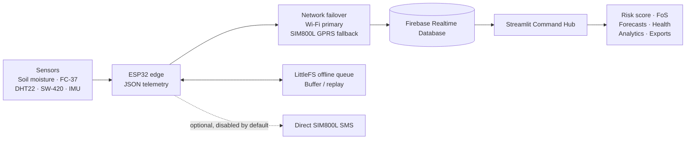

# GeoAlert — AI/IoT landslide-monitoring prototype

GeoAlert combines ESP32 sensor telemetry, Firebase Realtime Database, and a Streamlit Command Hub with an interactive architecture diagram, weighted hazard score, infinite-slope Factor of Safety (FoS), forecasts, anomaly checks and reports.

> **Security:** Wi-Fi and Firebase credentials, plus a Firebase service-account private key, were shared during troubleshooting. Treat them as compromised: change the Wi-Fi and Firebase Authentication passwords, revoke/delete the exposed service-account key in Google Cloud IAM, and restrict the Firebase Web API key. This version does not require a Firebase service-account file for its dashboard or firmware path. Never commit local secrets or service-account JSON.

## Architecture



The dashboard also includes an interactive Plotly architecture visualization. Telemetry paths are `/nodes/<node_id>/live` and `/nodes/<node_id>/history`. When both network links are unavailable, firmware can spool records to LittleFS and replay them after reconnection.

## Repository contents

- `firmware/src/main.cpp` and `firmware/platformio.ini`: ESP32 Arduino/PlatformIO firmware for soil moisture, FC-37, DHT22, SW-420, MPU-compatible IMU, Firebase REST, Wi-Fi/GPRS failover and LittleFS spool.
- `dashboard/app.py`: Streamlit Command Hub, Firebase live reader, hazard calculations, history, architecture visualization and exports.
- `train_models.py`: reproducible Random Forest, XGBoost and soft-voting training pipeline.
- `scripts/`: PowerShell configuration, setup, training, firmware build/upload/monitor and dashboard launchers.
- `docs/`: architecture, Firebase configuration and ML evaluation caveats.

Local credentials, model binaries and CSV files are excluded via `.gitignore`. Copy the training CSV into `data/geoalert_training_dataset.csv` before retraining.

## Quick start (Windows PowerShell)

From the GeoAlert project root:

```powershell
Set-ExecutionPolicy -Scope Process Bypass
.\scripts\setup.ps1
.\scripts\configure.ps1
```

Complete the Wi-Fi and Firebase prompts using newly rotated credentials. Keep `geoalert-node-01` as the Node ID unless the firmware intentionally uses another ID. Direct SIM800L SMS is optional, firmware-side, and disabled by default. No physical siren or relay is installed.

## Train models

The supplied dataset predictors are:

`soil_moisture, rainfall, temperature, humidity, roll, pitch, yaw, vibration`

The target is numeric `label` (classes 0 and 1). To retrain on Windows, ensure `data/geoalert_training_dataset.csv` exists, then run:

```powershell
.\scripts\train-models.ps1
```

The script writes trained models under `models/` and evaluation reports under `reports/`.

### Holdout metrics for the supplied CSV

A stratified 80/20 holdout with seed 42 yielded:

| Model | Accuracy | Macro F1 | ROC-AUC |
|---|---:|---:|---:|
| Random Forest | 99.70% | 99.70% | 0.9997 |
| XGBoost | 99.65% | 99.65% | 0.9998 |
| Soft-voting ensemble | 99.65% | 99.65% | 0.9997 |

These unusually strong metrics apply to the supplied dataset only and do not prove real-world landslide performance. See `docs/training-results.md`.

### Critical ML limitations

- The dataset does not define whether label 0 or 1 means normal, risk or landslide. It is binary and does not produce four hazard tiers.
- The rainfall unit is undocumented. FC-37 provides a wetness/index reading, not calibrated rainfall in millimetres.
- Firmware sensor units, IMU angle conventions and vibration aggregation must match the dataset before live model inference.
- The current dashboard uses a weighted heuristic and Factor of Safety. The trained artifacts are not wired into the live hazard tier. Do not treat binary classes as operational hazard tiers without validating semantics and units.

## Build and upload firmware

```powershell
.\scripts\build-firmware.ps1
.\scripts\upload-firmware.ps1
.\scripts\monitor-serial.ps1
```

The uploader asks for a COM port. Close the serial monitor before uploading. Pin map: soil GPIO 34, FC-37 GPIO 35, DHT22 GPIO 4, SW-420 GPIO 5, I2C SDA 21/SCL 22, SIM800L TXD to ESP32 RX GPIO 16 and ESP32 TX GPIO 17 to SIM800L RXD. Follow the exact SIM800L V2 board power requirements and use a shared ground.

## Run dashboard

```powershell
.\scripts\run-dashboard.ps1
```

Open http://localhost:8501. The dashboard is Streamlit-only and does not require a separate port-8000 API. If Firebase access is misconfigured, values may be demo/offline rather than live sensor readings.

## Alerts and safety

The dashboard records and displays events. Optional webhook escalation notifications can be configured in the sidebar. Direct SMS through SIM800L is a separate optional firmware feature and is disabled by default. This version has no cloud SMS worker or dashboard SMS queue; no physical siren or relay is installed. Logging or displaying an event does not prove that a person received an alert.

GeoAlert is an experimental decision-support prototype, not a certified landslide-warning system. Do not use it as the sole basis for evacuation or public-safety decisions. Validate sensors, soil/geotechnical parameters, thresholds and alert procedures with qualified personnel and local authorities.
