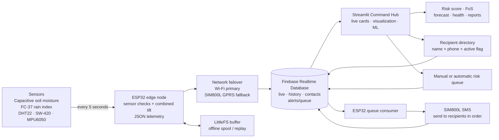

# GeoAlert — AI + IoT landslide-monitoring prototype

GeoAlert samples environmental and slope-orientation sensors on an ESP32 every five seconds, stores telemetry in Firebase Realtime Database, visualizes readings and analytics in a Streamlit dashboard, and uses a Firebase queue consumed by the ESP32/SIM800L to send messages to multiple registered contacts.

> **Credential warning:** A Wi-Fi password and Firebase credentials were included in the reference firmware shared during troubleshooting. Treat them as exposed: rotate the Wi-Fi password and Firebase Authentication password, restrict the Firebase Web API key, and revoke/delete the exposed Admin SDK service-account key in Google Cloud IAM. This redesigned dashboard/firmware path does not need an Admin SDK service-account JSON. Never commit `firmware/include/secrets.h` or `dashboard/.streamlit/secrets.toml`.

## Architecture



The dashboard also has an interactive Plotly **Architecture** tab. Live telemetry is stored at `/nodes/<node_id>/live`, history at `/nodes/<node_id>/history`, contacts at `/nodes/<node_id>/contacts`, and SMS jobs at `/nodes/<node_id>/alerts/queue`.

## End-to-end operation

1. **Sensor sampling:** capacitive soil-moisture ADC, FC-37 rain/wetness index, DHT22 temperature/humidity, SW-420 vibration pulses, and MPU6050 pitch/roll/yaw are sampled every five seconds.
2. **Consistent slope tilt:** the firmware and dashboard derive a single inclination value from both MPU6050 pitch and roll using the same formula. The dashboard's Slope Tilt value is not a separate sensor.
3. **Network and storage:** Wi-Fi is primary; SIM800L GPRS is the fallback. LittleFS buffers telemetry while both links are unavailable and replays it after reconnection.
4. **Firebase:** stores live telemetry, historical samples, names/phone numbers, and queued SMS requests.
5. **Streamlit:** shows real-time readings, hazard tier, factor of safety, history, forecasts, node health, model prediction and alert queue status. Operators can add, deactivate, and remove recipients.
6. **SMS:** the dashboard can queue a message for all active contacts. Automatic queueing is opt-in and responds to a live escalation to HIGH RISK or CRITICAL. The ESP32 polls the queue, sends messages sequentially using SIM800L, and records per-recipient results.

Queueing is not proof of SMS delivery. SMS requires stable SIM800L power, a ready SIM, cellular SMS service, and Firebase connectivity for the ESP32 to read and update the queue. No physical siren or relay is installed.

## Machine learning

The repository contains `train_models.py` and the model-training workflow. The **complete deployment ZIP** includes `data/geoalert_training_dataset.csv`, pre-trained artifacts under `models/`, and evaluation reports under `reports/`. The GitHub repository intentionally excludes the CSV and model binaries via `.gitignore`, so copy the CSV to `data/geoalert_training_dataset.csv` and train/download the included artifacts before using ML inference in a fresh Git clone.

The supplied dataset has features `soil_moisture, rainfall, temperature, humidity, roll, pitch, yaw, vibration` and binary target `label`. A stratified random 80/20 holdout reported about 99.65–99.70% accuracy on that dataset. **This is test-split accuracy, not demonstrated field accuracy.** The meaning of labels 0 and 1 is not documented, and dataset rainfall units have not been confirmed as equivalent to the FC-37 rain index. The dashboard displays `Label 0`/`Label 1` and probabilities, but does not map that output directly to operational risk tiers or SMS.

To retrain with labelled, documented, site-relevant data:

```powershell
.\scripts\train-models.ps1
```

Do not tune to a fixed 90–99% target by repeatedly inspecting the test set. Evaluate on separate sites/time periods and review false negatives before considering any safety-related use.

## Windows setup

Run from the project root:

```powershell
Set-ExecutionPolicy -Scope Process Bypass
.\scripts\setup.ps1
.\scripts\configure.ps1
```

Use newly rotated Wi-Fi/Firebase credentials. The configuration script creates local-only `firmware/include/secrets.h` and `dashboard/.streamlit/secrets.toml`.

### Firebase rules

The repository includes `firebase.json`, `.firebaserc`, and `database.rules.json`. Review the sample rules before deployment—deploying replaces the currently deployed database rules:

```powershell
firebase login
firebase use geoalert-ai-ee1fd
firebase deploy --only database --project geoalert-ai-ee1fd
```

The sample rules allow authenticated users to read node data and to write required live/history/contact/queue paths. They are a prototype baseline, not full per-user authorization.

## Build, upload, monitor

```powershell
.\scripts\build-firmware.ps1
.\scripts\upload-firmware.ps1
.\scripts\monitor-serial.ps1
```

Close the serial monitor before uploading. Default pins: soil GPIO 34, FC-37 GPIO 35, DHT22 GPIO 4, SW-420 GPIO 5, I²C SDA 21/SCL 22, SIM800L TXD → ESP32 RX GPIO 16 and ESP32 TX GPIO 17 → SIM800L RXD. Follow the exact SIM800L V2 board power specification and use a shared ground.

## Run the dashboard

```powershell
.\scripts\run-dashboard.ps1
```

Open `http://localhost:8501`. If it shows OFFLINE / DEMO, check Firebase Authentication, the database URL/rules, the selected node ID, and the ESP32 serial output. NTP time is used for calendar timestamps when available; uptime-only timestamps are not treated as real calendar times.

## Safety and validation

GeoAlert is an experimental decision-support prototype, not a certified landslide-warning system. Do not use it as the sole basis for evacuation or public-safety decisions. Validate sensors, field units, soil/geotechnical parameters, ML label semantics, thresholds and SMS delivery with qualified personnel and local authorities.
