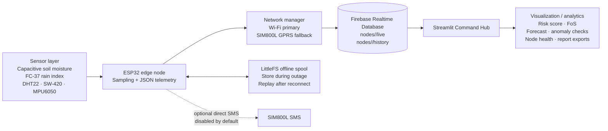

# GeoAlert architecture and current implementation

## Data path

1. Sensors are sampled by the ESP32 and assembled into a JSON telemetry object.
2. Wi-Fi is the preferred uplink. SIM800L GPRS is the fallback. If both uplinks fail, telemetry is written to LittleFS and replayed after reconnection.
3. Live data is written to `/nodes/<node_id>/live`; historical records are written to `/nodes/<node_id>/history`.
4. The Streamlit dashboard reads Firebase and presents live sensor values, node health, weighted hazard score, infinite-slope Factor of Safety, history, forecasts, anomaly indicators, map/fleet views and downloadable reports.
5. Webhook escalation notifications are optional and only work when a webhook URL is configured. Direct SIM800L SMS is an optional firmware-side feature and is disabled by default.

The repository does not include a cloud SMS worker or a dashboard SMS queue. No physical siren or relay is installed.

## Live-versus-demo behavior

The dashboard displays `LIVE STREAMING` only when a Firebase live record is returned for the selected node. If the node path is empty or inaccessible, inspect the serial monitor, Firebase Authentication, Realtime Database rules, database URL and firmware's configured node ID. Historical graphs may use synthetic fallback data when no device history is available.

## Current analytical limitations

The displayed hazard tier is based on a weighted heuristic and an infinite-slope FoS calculation. The separate training pipeline's supplied binary model is not wired into the live hazard tier. Its metrics should not be interpreted as validated field performance.
