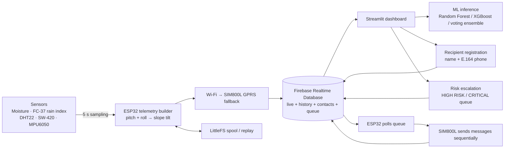

# GeoAlert architecture and data-flow details

## Firebase paths

- `/nodes/<node_id>/live`: latest telemetry JSON.
- `/nodes/<node_id>/history`: push-keyed telemetry samples.
- `/nodes/<node_id>/contacts/<contact_key>`: contact name, phone, active flag and creation time.
- `/nodes/<node_id>/alerts/queue/<queue_key>`: message, tier, recipient snapshots, queue status, per-recipient delivery statuses.

## Pitch / roll / slope-tilt consistency

The ESP32 and dashboard use:

`tilt_deg = degrees(acos(clamp(cos(radians(pitch)) * cos(radians(roll)), -1, 1)))`

This makes Slope Tilt a combined inclination derived from pitch and roll rather than an independent measurement. Yaw is available for model input/visualization but does not contribute to this tilt magnitude.

The ESP32 uses NTP time over Wi-Fi when available and publishes Unix milliseconds. If wall-clock synchronization is unavailable, it marks the timestamp as uptime; the dashboard ignores uptime-only historical times instead of fabricating calendar dates.

## Alert lifecycle

1. An operator enters recipient name and international-format phone number in the Streamlit dashboard. The contact is saved in Firebase.
2. Manual dispatch can queue a message for all active contacts. If the dashboard's automatic SMS option is enabled, a live escalation to HIGH RISK or CRITICAL also creates a queue item.
3. The ESP32 polls the latest queue items approximately every 10 seconds over the active Firebase connection. It leaves jobs queued if the SIM800L isn't ready, otherwise marks one item `processing`.
4. It sends sequentially through SIM800L and writes each result plus a final `sent`, `partial`, or `failed` state.
5. A job that remains `processing` is not silently resent because some recipients may already have received it. Check individual status and use a new job for a deliberate retry.

## Machine learning

The dashboard loads `models/voting_ensemble_model.pkl` and shows binary prediction/probabilities plus held-out metrics from `reports/training_report.json`. The supplied dataset doesn't document class meanings or confirmed rainfall units, so the ML output is informational and cannot independently trigger SMS. The live risk tier remains the transparent weighted sensor / infinite-slope Factor-of-Safety heuristic.

## Limitations

- The example Firebase rules are a prototype baseline. Tighten access to per-user/per-device permissions before broader deployment.
- Firebase connectivity is required for the ESP32 to read and update the SMS queue. If cellular data is down, queued jobs wait until database connectivity returns.
- SIM800L SMS delivery requires suitable power, a ready SIM and network SMS support. A successful modem command is not a guaranteed proof of handset delivery.
- This system is not certified for use as the sole basis of emergency action.
